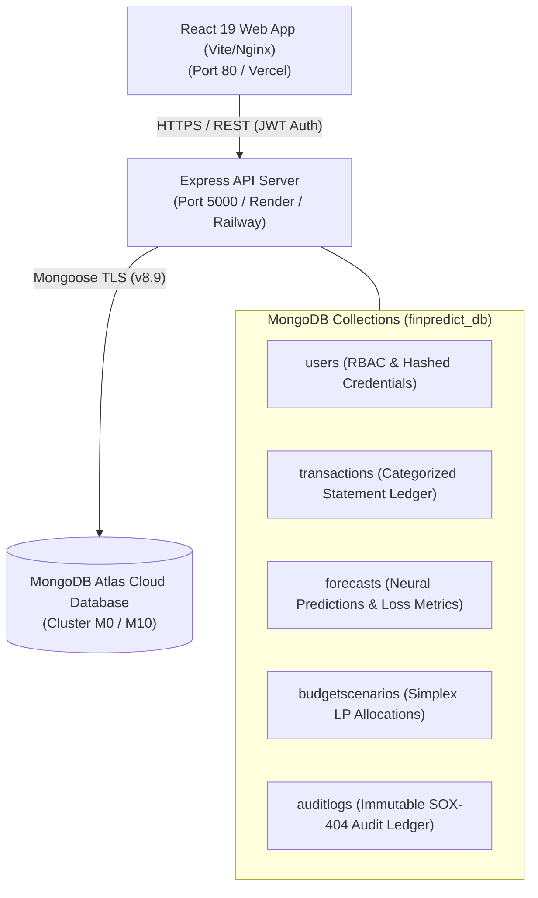

# FinPredict FP&A: MongoDB Cloud Deployment Guide

This guide provides end-to-end instructions for deploying the **FinPredict** enterprise platform with a cloud **MongoDB** database, **Express/Node.js** API server, and **React 19** frontend.

---

## 1. Architecture Overview



---

## 2. Directory Structure

```text
FinPredict/
├── DEPLOYMENT_MONGODB.md       # Step-by-step deployment guide
├── Dockerfile                  # Frontend production container (Nginx)
├── docker-compose.yml          # Full-stack composition (MongoDB + Backend + Frontend)
├── server/                     # Node.js + Express + Mongoose Backend
│   ├── Dockerfile              # Backend production container
│   ├── package.json            # Backend dependencies
│   ├── tsconfig.json           # Backend TypeScript config
│   ├── .env                    # Local environment variables
│   ├── .env.example            # Environment template
│   └── src/
│       ├── config/db.ts        # Mongoose database connector
│       ├── models/             # User, Transaction, Forecast, BudgetScenario, AuditLog
│       ├── middleware/         # JWT Auth & Role-Based Access Control (RBAC)
│       ├── routes/             # auth, transactions, forecast, simplex, reports
│       └── index.ts            # Main Express application entrypoint
└── src/                        # React 19 Frontend
    └── services/apiClient.ts   # Client-side API connector
```

---

## 3. Step 1: Set Up MongoDB Atlas

1. Visit [MongoDB Atlas](https://www.mongodb.com/cloud/atlas) and log in or register.
2. Click **Create a Deployment** and choose the **M0 Free Tier** (or M10 dedicated cluster).
3. Set your cluster name to `FinPredictCluster`.
4. Create a Database User:
   - **Username**: `finpredict_admin`
   - **Password**: `<secure_password>` (e.g., `FinPredict2026!DbSecret`)
   - **Role**: `Read and write to any database`
5. Configure Network Access:
   - Go to **Security → Network Access**.
   - Click **Add IP Address** and select `Allow Access From Anywhere` (`0.0.0.0/0`) so cloud servers (Render, Railway, or Vercel) can connect.
6. Copy the connection string:
   ```text
   mongodb+srv://finpredict_admin:<secure_password>@finpredictcluster.abcde.mongodb.net/finpredict_db?retryWrites=true&w=majority
   ```

---

## 4. Step 2: Test the Backend Locally

In your terminal:

```powershell
cd server
npm install
npm run dev
```

You should see:
```text
🍃 [MongoDB] Successfully connected to database: finpredict_db
🚀 [FinPredict Server] Running on http://localhost:5000
📡 [FinPredict Server] Health check: http://localhost:5000/api/health
```

Seed the default demo accounts into MongoDB with a single POST request:
```powershell
curl -X POST http://localhost:5000/api/auth/seed
```
This initializes the database with:
- **Analyst User**: `analyst` (Password: `DemoPass2026!`)
- **Compliance Admin**: `admin` (Password: `DemoPass2026!`)

---

## 5. Step 3: Deploy Backend to Cloud (Render / Railway)

### Using [Render](https://render.com) (Recommended)
1. Push your repository to GitHub.
2. In Render Dashboard, click **New + → Web Service**.
3. Select your repository.
4. Set configurations:
   - **Root Directory**: `server`
   - **Environment**: `Node`
   - **Build Command**: `npm install && npm run build`
   - **Start Command**: `npm start`
5. Under **Environment Variables**, add:
   - `NODE_ENV`: `production`
   - `PORT`: `5000`
   - `MONGODB_URI`: `<your MongoDB Atlas connection string>`
   - `JWT_SECRET`: `<generate a 64-char random string>`
   - `CLIENT_URL`: `https://your-frontend-app.vercel.app`
6. Click **Deploy Web Service** and copy your backend URL (e.g. `https://finpredict-api.onrender.com`).

---

## 6. Step 4: Deploy Frontend to Vercel / Netlify

1. In [Vercel](https://vercel.com), click **Add New → Project**.
2. Select your repository.
3. Configure project settings:
   - **Framework Preset**: `Vite`
   - **Root Directory**: `./`
   - **Build Command**: `npm run build`
   - **Output Directory**: `dist`
4. Under **Environment Variables**, add:
   - `VITE_API_URL`: `https://finpredict-api.onrender.com/api`
5. Click **Deploy**.

---

## 7. Step 5: Full-Stack Docker Deployment (Alternative Self-Hosted)

If deploying to your own Virtual Private Server (VPS), AWS EC2, or DigitalOcean Droplet:

```bash
docker compose up -d --build
```

This launches all three services simultaneously:
- **MongoDB 7.0**: Port `27017`
- **Express Backend**: Port `5000`
- **React Nginx Frontend**: Port `80` (accessible at `http://your-server-ip`)
